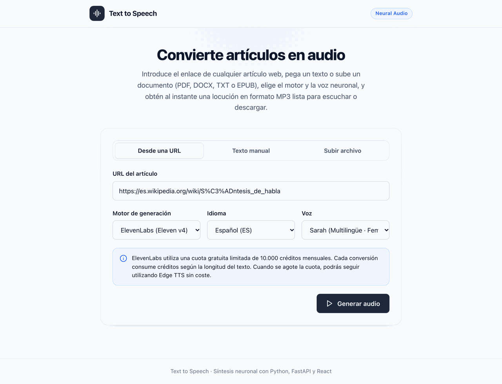
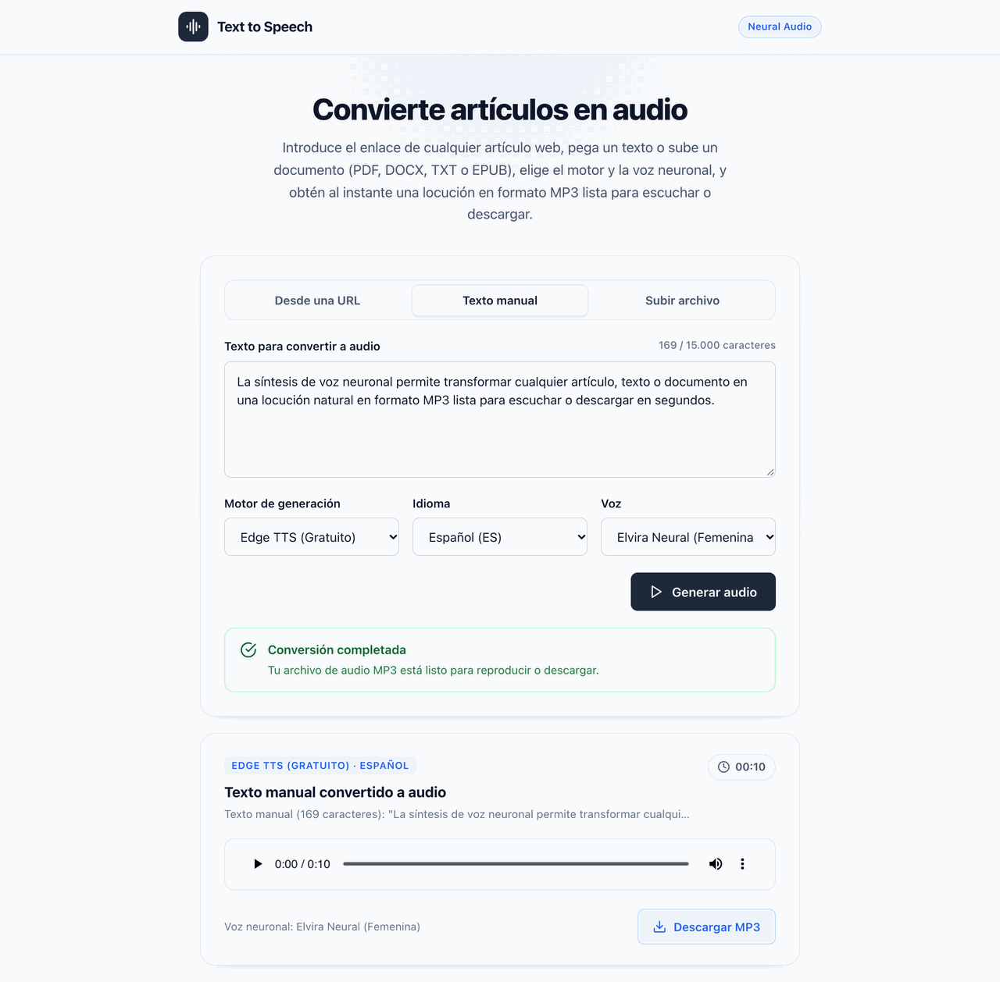
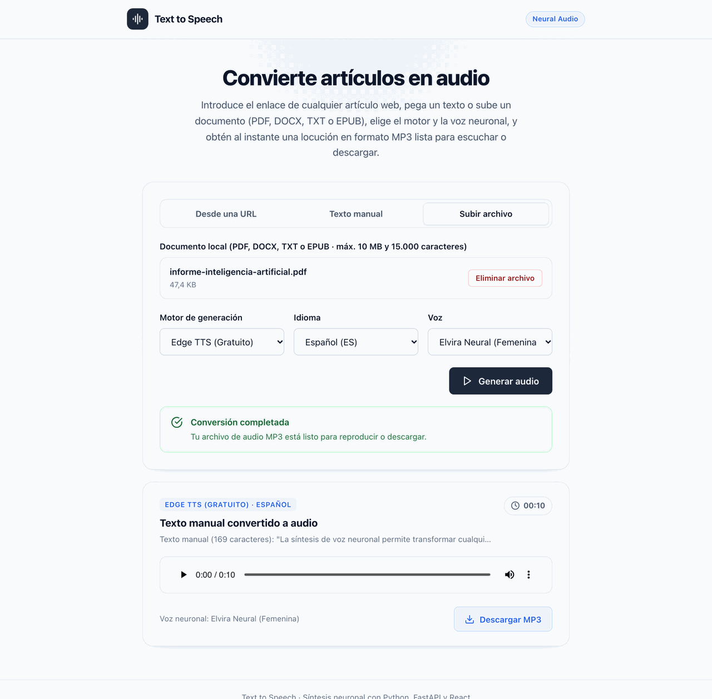

# Text to Speech v2

> 🌐 **Languages / Idiomas:** [English](#english-version) | [Español](#versión-en-español)
>
> 🔗 **Live Application / Aplicación desplegada:**
> - **Frontend (Cloudflare Pages):** [https://text-to-speech-3ir.pages.dev](https://text-to-speech-3ir.pages.dev)
> - **Backend API (Render):** [https://text-to-speech-api-yfia.onrender.com/api/health](https://text-to-speech-api-yfia.onrender.com/api/health) · [Swagger Docs (`/docs`)](https://text-to-speech-api-yfia.onrender.com/docs)
> - **GitHub Repository:** [https://github.com/gemaespada/text-to-speech](https://github.com/gemaespada/text-to-speech)

---

## English Version

### 1. Project Overview

**Text to Speech v2** is a full-stack web application and CLI tool built with **Python (FastAPI)** and **React + Vite** that transforms online web articles, manually pasted text, and local documents (**PDF, DOCX, TXT, and EPUB**) into playable and downloadable MP3 audio files using neural speech synthesis.

Users can choose between **three input modes** and **two neural speech engines**:
- **Edge TTS (`edge`):** Free, key-less neural speech synthesis powered by Microsoft Edge TTS.
- **ElevenLabs (`elevenlabs`):** Expressive multilingual neural synthesis powered by the official ElevenLabs REST API using the **`eleven_v4`** model (`mp3_44100_128`).

---

### 2. Application Screenshots

#### Mode A — Article URL Input & ElevenLabs (`eleven_v4`) Quota Notice


#### Mode B — Manual Text Input, Edge TTS & Audio Result Player


#### Mode C — Local File Upload (PDF, DOCX, TXT, EPUB)


---

### 3. Main Features & Input Modes

| Input Mode | Endpoint | Description |
| :--- | :--- | :--- |
| **A. From a URL** | `POST /api/tts` | Downloads and extracts the main article content from a public `http://` or `https://` web page (up to 5 MB HTML and 15,000 characters), with SSRF protection and URL conversion caching. If extraction is blocked by the remote site, the UI offers a one-click switch to Manual Text or File Upload while preserving your selected engine, language, and voice. |
| **B. Manual Text** | `POST /api/tts/text` | Allows pasting or typing plain text directly in the browser with a live character counter (up to 15,000 characters). Sent directly to the backend without simulating a URL and never stored in persistent cache. |
| **C. Local File Upload** | `POST /api/tts/file` | Accepts **`.pdf`**, **`.docx`**, **`.txt`**, and **`.epub`** files (up to 10 MB and 15,000 extracted characters). Displays file name and size before converting, allows removing/replacing the file, and validates real binary signatures (magic bytes) and package structure on the backend. |

---

### 4. Speech Engines, Languages & Dynamic Voice Selection

All three input modes share the same synchronized three-selector system (**Engine → Language → Voice**) powered by `GET /api/languages`:

| Aspect | Edge TTS (`edge`) | ElevenLabs (`elevenlabs`) |
| :--- | :--- | :--- |
| **Cost & Quota** | Free, no API key required. | Limited Free Tier (**10,000 monthly credits**); each conversion consumes credits based on text length. |
| **Model & Format** | Microsoft Edge Neural (`audio/mpeg`) | **`eleven_v4`** (`mp3_44100_128` — 44.1 kHz, 128 kbps). |
| **Spanish (`es`) Voices** | `es-ES-ElviraNeural` *(default)*, `es-ES-AlvaroNeural` | `Sarah` *(default)*, `Alice`, `Laura`, `Matilda`, `Roger`, `George`, `Liam`, `Charlie` |
| **English (`en`) Voices** | `en-US-AriaNeural` *(default)*, `en-US-GuyNeural` | `Alice` *(default)*, `Sarah`, `Laura`, `Matilda`, `Roger`, `George`, `Liam`, `Charlie` |
| **French (`fr`) Voices** | `fr-FR-DeniseNeural` *(default)*, `fr-FR-HenriNeural` | `Laura` *(default)*, `Sarah`, `Alice`, `Matilda`, `Roger`, `George`, `Liam`, `Charlie` |

- **ElevenLabs Quota Notice:** Selecting **ElevenLabs** displays a visible warning informing the user of the 10,000 monthly credit limit and reminding them that **Edge TTS** remains available at no cost.
- **Manual Fallback on Error:** If an ElevenLabs request fails (missing/invalid API key, exhausted quota, rate limit, or timeout), any previous audio result remains playable and the UI provides a button to **manually switch to Edge TTS** (never switching engines automatically without user consent).
- **Render Cold-Start UX:** Because Render Free suspends inactive services, if the backend takes more than 4 seconds to respond, the UI displays a clear wake-up notice (*"El servidor se está iniciando. Puede tardar unos segundos; estamos preparando la conversión."*) without triggering duplicate requests or automatic retries that could consume ElevenLabs credits.

---

### 5. Architecture, Security & Conversion Cache

#### Technologies Used

| Component | Technologies |
| :--- | :--- |
| **Backend** | Python 3.9+ / 3.11, FastAPI, Uvicorn, Pydantic v2 |
| **Extraction & NLP** | `newspaper3k`, `NLTK` (`punkt`, `punkt_tab`), `lxml<5.2.0`, `BeautifulSoup4`, `pypdf`, `python-docx`, `python-multipart` |
| **Speech Engines** | `edge-tts` (`aiohttp`), ElevenLabs REST API (`requests`, model `eleven_v4`) |
| **Frontend** | React 18, Vite 8, Pure Responsive CSS |
| **Automated Testing** | `pytest` & `unittest` (67 automated tests with mocks) |

#### Security Controls

- **SSRF & Network Hardening (`src/extractor.py`):** Only `http` (port 80) and `https` (port 443) are allowed. DNS is resolved once per socket connection (`SafeHTTPAdapter`), blocking private, loopback, link-local, multicast, and cloud metadata IPs (`127.0.0.1`, `10.0.0.0/8`, `172.16.0.0/12`, `192.168.0.0/16`, `169.254.169.254`, `::1`, `.local`, `.internal`). Every HTTP redirect hop is re-validated manually (max 5 redirects).
- **Document Upload Hardening (`src/document_extractor.py`):**
  - Sanitizes filenames against path traversal (`../`) and null bytes.
  - Validates extension, declared MIME type, and **real binary magic bytes / package structure** (`%PDF-` header for PDF; `PK\x03\x04` ZIP structure with `word/document.xml` for DOCX or `META-INF/container.xml` for EPUB; binary signature rejection for TXT).
  - Enforces a 10 MB upload cap (`MAX_UPLOAD_FILE_BYTES`), a 25 MB uncompressed ZIP payload cap (ZIP-bomb protection), and rejects XML `<!DOCTYPE` / `<!ENTITY` declarations (XXE / Billion Laughs protection).
  - Never executes embedded macros, scripts, or active document objects.
- **Content Size & Rate Limits (`backend/security.py`):** Raw HTML downloads are capped at 5 MB, extracted text at **15,000 characters** (`MAX_ARTICLE_CHARS`), and conversions are rate-limited per client IP (`InMemoryRateLimiter`: 5 requests / 60 seconds by default).
- **Temporary File Lifecycle (`backend/main.py`):** Each synthesis request uses an isolated temporary directory (`tts_req_*`) protected by an OS-level exclusive lock (`fcntl.flock` on `.active.lock`). `SafeFileResponse` guarantees cleanup both on normal completion and if the HTTP client disconnects mid-stream (`OSError` / `asyncio.CancelledError`).
- **API Key Protection:** `ELEVENLABS_API_KEY` is read exclusively on the backend from environment variables or the git-ignored `.env` file, and is never exposed in frontend code, logs, error responses, or screenshots.

#### URL Conversion Cache (`backend/cache.py`)

- **Scope:** Applies exclusively to URL conversions (`POST /api/tts`). Manual text and uploaded local documents are **never** cached to protect user privacy.
- **Cache Key Isolation:** Computed as a 64-character SHA-256 hex digest over the canonical JSON tuple `(url, engine, language, voice)`. Requests with a different engine, language, or voice never collide.
- **Efficiency & Limits:** Cache hits (`X-Cache: HIT`) copy the cached MP3 into the request's locked temporary directory and stream it immediately without re-downloading the article or consuming ElevenLabs credits. Entries expire after `TTS_CACHE_TTL_SECONDS` (default: 3600s / 1 hour) and are bounded by `TTS_CACHE_MAX_ENTRIES` (default: 50) and `TTS_CACHE_MAX_BYTES` (default: 100 MB) using an LRU eviction policy.
- **Limitation on Render Free:** Because Render Free uses ephemeral container storage and suspends instances after inactivity, cached entries live for the duration of the active container instance.

---

### 6. Project Structure

```text
text-to-speech/
├── backend/
│   ├── cache.py                  # Thread-safe LRU + TTL disk cache for URL conversions
│   ├── main.py                   # FastAPI application, endpoints (/api/tts, /text, /file), temp lifecycle
│   ├── schemas.py                # Pydantic schemas for URL/Text requests and engine catalogs
│   └── security.py               # SSRF exports, 15,000-char limit, IP resolution, rate limiter
├── docs/
│   └── screenshots/              # Real optimized screenshots of the application
│       ├── 01-url-mode-elevenlabs.png
│       ├── 02-manual-text-and-player.png
│       └── 03-file-upload-mode.png
├── frontend/
│   ├── src/
│   │   ├── components/           # Header, HeroSection, ConversionForm, StatusBanner, AudioResultCard
│   │   ├── App.jsx               # Main coordinator, 3 input modes, dynamic selectors, cold-start UX
│   │   ├── index.css             # Pure CSS responsive styles
│   │   └── main.jsx              # React entry point
│   ├── .env.example              # Frontend environment variable template (VITE_API_BASE_URL)
│   ├── package.json
│   └── vite.config.js            # Vite server and local /api proxy
├── src/
│   ├── converter.py              # Dual-engine TTS synthesis (Edge TTS + ElevenLabs eleven_v4)
│   ├── document_extractor.py     # Safe text extraction for PDF, DOCX, TXT, and EPUB uploads
│   ├── extractor.py              # SSRF-safe web article downloading and extraction
│   └── main.py                   # Interactive CLI entry point
├── tests/
│   ├── test_temp_lifecycle.py          # 14 tests for temp lifecycle, disconnect cleanup, ports
│   ├── test_dual_engine_tts.py         # 10 tests for dual engine, ElevenLabs v4, and error handling
│   └── test_v2_inputs_cache_security.py # 43 pytest tests for URL SSRF, text, files, and caching
├── .env.example                  # Backend environment variable template
├── render.yaml                   # Render deployment blueprint
├── requirements.txt              # Python dependencies
└── README.md                     # Bilingual documentation (EN / ES)
```

---

### 7. Local Installation, Environment Setup & Execution

1. **Clone the repository and install backend dependencies:**

   ```bash
   git clone https://github.com/gemaespada/text-to-speech.git
   cd text-to-speech
   python3 -m venv .venv
   source .venv/bin/activate
   pip install -r requirements.txt
   ```

2. **Install frontend dependencies:**

   ```bash
   cd frontend
   npm install
   cd ..
   ```

3. **Configure environment variables (`.env` from `.env.example`):**

   Copy `.env.example` to `.env` in the project root (already ignored by `.gitignore`) and optionally set your `ELEVENLABS_API_KEY`:

   ```bash
   cp -n .env.example .env
   ```

   Key variables in `.env.example`:
   - `PORT=8000`
   - `FRONTEND_ORIGINS=http://localhost:5173,http://127.0.0.1:5173`
   - `MAX_ARTICLE_CHARS=15000`
   - `RATE_LIMIT_REQUESTS=5` / `RATE_LIMIT_WINDOW_SECONDS=60`
   - `TTS_CACHE_TTL_SECONDS=3600` / `TTS_CACHE_MAX_ENTRIES=50` / `TTS_CACHE_MAX_BYTES=104857600`
   - `ELEVENLABS_API_KEY=` *(optional: leave empty to use only Edge TTS, or paste your key locally)*

4. **Start both services locally:**

   - **Terminal 1 — FastAPI Backend (`http://127.0.0.1:8000`):**
     ```bash
     ./.venv/bin/python -m uvicorn backend.main:app --reload --port 8000
     ```
   - **Terminal 2 — React + Vite Frontend (`http://localhost:5173`):**
     ```bash
     cd frontend
     npm run dev
     ```

5. **Run the automated test suite (`pytest`):**

   ```bash
   ./.venv/bin/python -m pytest -v
   ```

---

### 8. Known Limitations

1. **Scanned PDFs (No OCR):** PDF extraction parses embedded text streams using `pypdf`. Scanned image-only PDFs that require Optical Character Recognition (OCR) are not supported in this version and return an explanatory message.
2. **Character & File Size Caps:** Extracted content from any mode is capped at **15,000 characters** (`HTTP 413`), uploaded files at **10 MB**, and downloaded web HTML at **5 MB**.
3. **ElevenLabs Free Tier & Cloud Datacenter IPs:** The ElevenLabs Free plan provides 10,000 monthly credits and restricts community Voice Library voices (`HTTP 402`) as well as requests originating from shared datacenter IPs like Render (`detected_unusual_activity`). When running on Render without a paid ElevenLabs plan, users can switch to **Edge TTS** at any time at no cost.

---
---

## Versión en Español

### 1. Descripción del proyecto

**Text to Speech v2** es una aplicación web *full-stack* y herramienta CLI desarrollada con **Python (FastAPI)** y **React + Vite** que transforma artículos web, textos pegados manualmente y documentos locales (**PDF, DOCX, TXT y EPUB**) en archivos de audio MP3 reproducibles y descargables mediante síntesis de voz neuronal.

La aplicación permite combinar **tres modalidades de entrada** con **dos motores de síntesis de voz**:
- **Edge TTS (`edge`):** Motor neuronal gratuito que no requiere registro ni clave API, basado en Microsoft Edge TTS.
- **ElevenLabs (`elevenlabs`):** Motor neuronal expresivo multilingüe conectado a la API REST oficial de ElevenLabs con el modelo **`eleven_v4`** (`mp3_44100_128`).

---

### 2. Capturas reales de la aplicación

#### Modalidad A — Desde una URL y aviso de cuota gratuita de ElevenLabs (`eleven_v4`)


#### Modalidad B — Texto manual, Edge TTS y reproductor de audio MP3


#### Modalidad C — Subida de archivo local (PDF, DOCX, TXT, EPUB)


---

### 3. Modalidades de entrada

| Modalidad | Endpoint | Descripción |
| :--- | :--- | :--- |
| **A. Desde una URL** | `POST /api/tts` | Descarga y extrae el contenido principal de un artículo web público `http://` o `https://` (hasta 5 MB de HTML y 15.000 caracteres), con protección SSRF y caché de conversiones. Si la página bloquea la extracción automática, la interfaz informa del motivo y ofrece botones para cambiar a **Texto manual** o **Subir archivo** sin perder la configuración de motor, idioma y voz. |
| **B. Texto manual** | `POST /api/tts/text` | Permite escribir o pegar directamente el texto en el navegador con contador de caracteres en tiempo real (hasta 15.000 caracteres). Se envía directamente al backend sin simular una URL y nunca se almacena en la caché persistente. |
| **C. Subir archivo** | `POST /api/tts/file` | Admite documentos **`.pdf`**, **`.docx`**, **`.txt`** y **`.epub`** (hasta 10 MB de archivo y 15.000 caracteres extraídos). Muestra el nombre y tamaño antes de convertir, permite eliminar el archivo para elegir otro y valida en el backend la extensión, el MIME, los *magic bytes* reales y la estructura interna del documento. |

---

### 4. Motores de voz, idiomas y selección dinámica de voces

Las tres modalidades de entrada comparten los mismos tres selectores dinámicos sincronizados (**Motor de generación → Idioma → Voz**) alimentados por `GET /api/languages`:

| Característica | Edge TTS (`edge`) | ElevenLabs (`elevenlabs`) |
| :--- | :--- | :--- |
| **Coste y cuota** | Gratuito, sin clave API. | Cuota gratuita limitada (**10.000 créditos mensuales**); cada conversión consume créditos según la longitud del texto. |
| **Modelo y formato** | Microsoft Edge Neural (`audio/mpeg`) | **`eleven_v4`** (`mp3_44100_128` — 44.1 kHz, 128 kbps). |
| **Voces en Español (`es`)** | `es-ES-ElviraNeural` *(por defecto)*, `es-ES-AlvaroNeural` | `Sarah` *(por defecto)*, `Alice`, `Laura`, `Matilda`, `Roger`, `George`, `Liam`, `Charlie` |
| **Voces en Inglés (`en`)** | `en-US-AriaNeural` *(por defecto)*, `en-US-GuyNeural` | `Alice` *(por defecto)*, `Sarah`, `Laura`, `Matilda`, `Roger`, `George`, `Liam`, `Charlie` |
| **Voces en Francés (`fr`)** | `fr-FR-DeniseNeural` *(por defecto)*, `fr-FR-HenriNeural` | `Laura` *(por defecto)*, `Sarah`, `Alice`, `Matilda`, `Roger`, `George`, `Liam`, `Charlie` |

- **Aviso sobre la cuota de ElevenLabs:** Al seleccionar **ElevenLabs**, se muestra el aviso sobre el límite de 10.000 créditos mensuales y la disponibilidad gratuita de Edge TTS. Al cambiar a **Edge TTS**, el aviso desaparece.
- **Recuperación ante errores y cambio manual:** Si ElevenLabs devuelve un error (clave ausente o inválida, cuota agotada, límite de peticiones o *timeout*), la aplicación conserva el audio anterior disponible, informa del problema y muestra un botón para **cambiar manualmente a Edge TTS** (nunca cambia de motor sin consentimiento del usuario).
- **Experiencia durante el arranque en frío de Render (*Cold Start*):** En el plan gratuito de Render el servicio se suspende tras periodos de inactividad. Si el backend tarda más de 4 segundos en responder, la interfaz muestra el mensaje *«El servidor se está iniciando. Puede tardar unos segundos; estamos preparando la conversión.»*, manteniendo el estado de carga activo, bloqueando envíos duplicados y sin realizar reintentos automáticos que pudieran consumir créditos de ElevenLabs.

---

### 5. Arquitectura, seguridad y caché de conversiones

#### Tecnologías utilizadas

| Componente | Tecnologías |
| :--- | :--- |
| **Backend** | Python 3.9+ / 3.11, FastAPI, Uvicorn, Pydantic v2 |
| **Extracción y NLP** | `newspaper3k`, `NLTK` (`punkt`, `punkt_tab`), `lxml<5.2.0`, `BeautifulSoup4`, `pypdf`, `python-docx`, `python-multipart` |
| **Motores de voz** | `edge-tts` (`aiohttp`), API REST oficial de ElevenLabs (`requests`, modelo `eleven_v4`) |
| **Frontend** | React 18, Vite 8, CSS puro *responsive* |
| **Pruebas automatizadas** | `pytest` y `unittest` (67 pruebas automatizadas con *mocks*) |

#### Características de seguridad

- **Protección SSRF y validación de red (`src/extractor.py`):** Solo se permiten esquemas `http` (puerto 80) y `https` (puerto 443) sin credenciales embebidas. El adaptador `SafeHTTPAdapter` resuelve DNS una única vez por conexión y bloquea IPs privadas, *loopback*, *link-local* y metadatos cloud (`127.0.0.1`, `10.0.0.0/8`, `172.16.0.0/12`, `192.168.0.0/16`, `169.254.169.254`, `::1`, `.local`, `.internal`). Cada salto de redirección HTTP se valida manualmente (máximo 5 redirecciones).
- **Seguridad en la subida de documentos (`src/document_extractor.py`):**
  - Sanitización del nombre de archivo contra *path traversal* (`../`) y bytes nulos.
  - Verificación de extensión, tipo MIME declarado y **contenido binario real (*magic bytes* y estructura interna)**: cabecera `%PDF-` para PDF; archivo ZIP válido con `[Content_Types].xml` y `word/document.xml` para DOCX; archivo ZIP con `META-INF/container.xml` y manifiesto `.opf` para EPUB; rechazo de firmas binarias y bytes nulos para TXT.
  - Límite de 10 MB por archivo subido (`MAX_UPLOAD_FILE_BYTES`), límite de 25 MB descomprimidos para archivos ZIP (protección contra *ZIP bombs*) y bloqueo de declaraciones XML `<!DOCTYPE` / `<!ENTITY` (protección contra XXE).
  - Nunca se interpreta ni ejecuta código, scripts ni contenido activo dentro de los documentos.
- **Límite de caracteres y Rate Limiting (`backend/security.py`):** Límite de 5 MB de HTML descargado, **15.000 caracteres** de texto extraído (`MAX_ARTICLE_CHARS`) en cualquiera de las tres modalidades y limitador en memoria por IP (`InMemoryRateLimiter`: 5 peticiones cada 60 segundos).
- **Ciclo de vida de archivos temporales (`backend/main.py`):** Cada conversión crea un directorio temporal aislado (`tts_req_*`) protegido con un bloqueo exclusivo del sistema operativo (`fcntl.flock` sobre `.active.lock`). `SafeFileResponse` garantiza la eliminación del directorio y la liberación del bloqueo tanto al finalizar la descarga como si el cliente se desconecta a mitad de la transmisión.
- **Protección de `ELEVENLABS_API_KEY`:** La clave se lee exclusivamente en el backend desde variables de entorno o desde el archivo `.env` local (excluido de Git) y jamás se incluye en el frontend, logs, respuestas de error ni capturas.

#### Funcionamiento de la caché de conversiones (`backend/cache.py`)

- **Ámbito:** Se aplica únicamente a conversiones desde **URL** (`POST /api/tts`). Los textos manuales y los archivos locales subidos por el usuario **nunca se almacenan en caché** por privacidad.
- **Clave de caché:** Hash SHA-256 hexadecimal de 64 caracteres calculado sobre la tupla canónica `(url, engine, language, voice)`. Cualquier cambio de motor, idioma o voz genera una clave distinta.
- **Ahorro de recursos y política de limpieza:** En caso de acierto (`X-Cache: HIT`), el backend copia el MP3 almacenado al directorio temporal bloqueado de la petición y lo transmite inmediatamente sin volver a descargar la página ni consumir créditos de ElevenLabs. La caché aplica caducidad por tiempo (`TTS_CACHE_TTL_SECONDS`, por defecto 3600 s / 1 hora), límite de entradas (`TTS_CACHE_MAX_ENTRIES`, por defecto 50) y tamaño máximo total (`TTS_CACHE_MAX_BYTES`, por defecto 100 MB) con expulsión LRU (*Least Recently Used*).
- **Limitación en Render Free:** Dado que el almacenamiento local de Render Free es efímero, la caché persiste en disco mientras la instancia del contenedor permanece activa.

---

### 6. Instrucciones para ejecutar el proyecto localmente

1. **Clonar el repositorio e instalar dependencias del backend:**

   ```bash
   git clone https://github.com/gemaespada/text-to-speech.git
   cd text-to-speech
   python3 -m venv .venv
   source .venv/bin/activate
   pip install -r requirements.txt
   ```

2. **Instalar dependencias del frontend:**

   ```bash
   cd frontend
   npm install
   cd ..
   ```

3. **Configurar variables de entorno (`.env` a partir de `.env.example`):**

   Copia la plantilla `.env.example` a `.env` en la raíz del proyecto (el archivo `.env` está excluido de Git mediante `.gitignore`):

   ```bash
   cp -n .env.example .env
   ```

   Variables disponibles en `.env.example`:
   - `PORT=8000`: Puerto del servidor FastAPI.
   - `FRONTEND_ORIGINS=http://localhost:5173,http://127.0.0.1:5173`: Orígenes permitidos por CORS.
   - `MAX_ARTICLE_CHARS=15000`: Límite máximo de caracteres extraídos por conversión.
   - `RATE_LIMIT_REQUESTS=5` y `RATE_LIMIT_WINDOW_SECONDS=60`: Límite de peticiones por IP.
   - `TTS_CACHE_TTL_SECONDS=3600`, `TTS_CACHE_MAX_ENTRIES=50`, `TTS_CACHE_MAX_BYTES=104857600`: Parámetros de la caché de URLs.
   - `ELEVENLABS_API_KEY=`: Clave privada de ElevenLabs (opcional; si se deja vacía, **Edge TTS** funciona con total normalidad).

4. **Arrancar ambos servicios en local:**

   - **Terminal 1 — Backend FastAPI (`http://127.0.0.1:8000`):**
     ```bash
     ./.venv/bin/python -m uvicorn backend.main:app --reload --port 8000
     ```
   - **Terminal 2 — Frontend React + Vite (`http://localhost:5173`):**
     ```bash
     cd frontend
     npm run dev
     ```
   - Abre `http://localhost:5173/` en tu navegador.

5. **Ejecutar la batería de pruebas automatizadas (`pytest`):**

   ```bash
   ./.venv/bin/python -m pytest -v
   ```

---

### 7. Límites de uso y restricciones conocidas

1. **PDFs escaneados sin texto (OCR):** La extracción de PDF utiliza `pypdf` sobre el texto digital embebido. Los documentos PDF escaneados formados únicamente por imágenes (que requieren OCR) no están soportados en esta versión y muestran un aviso explicativo al usuario.
2. **Límites de tamaño:** El texto extraído en cualquiera de las tres modalidades tiene un límite máximo de **15.000 caracteres** (`HTTP 413`), los archivos subidos un máximo de **10 MB** y la descarga HTML de artículos web un máximo de **5 MB**.
3. **Plan gratuito de ElevenLabs e IPs de centros de datos:** El plan gratuito de ElevenLabs incluye 10.000 créditos mensuales, restringe el uso por API de voces comunitarias de la *Voice Library* (`HTTP 402`) y puede bloquear peticiones procedentes de direcciones IP compartidas de servidores cloud como Render (`detected_unusual_activity`). En cualquiera de estos casos, el usuario puede cambiar con un clic a **Edge TTS** para seguir generando audio de forma gratuita.
